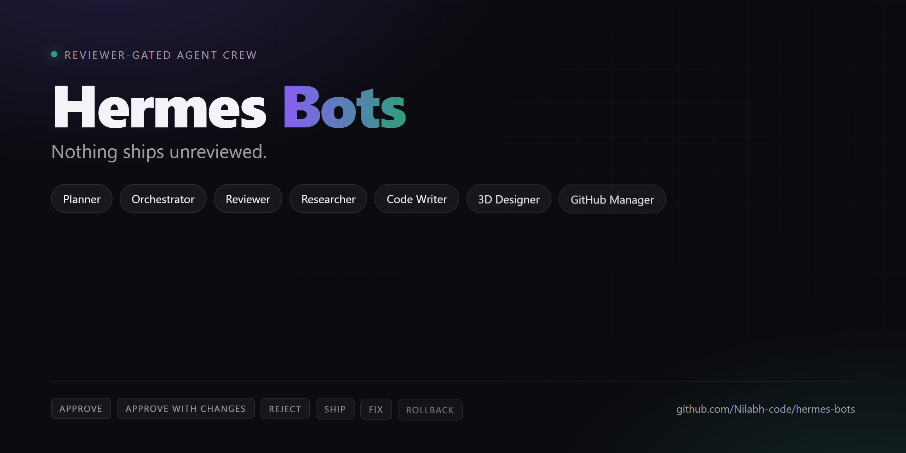

# Hermes Bots



A small crew of specialist AI agents for [Hermes Agent](https://hermes-agent.nousresearch.com/docs), built around one rule:

> **Nothing ships unreviewed.**

Most agent setups use one model that plans, executes, and grades its own homework in the same conversation — which is not a review, it is a monologue with a rubber stamp. Here, planning, execution, and review are **three separate profiles in separate sessions**, and the plan has to survive an adversarial review *before* anything runs, and the result has to survive an evidence audit *after*.

## The crew

| Bot | Role |
|---|---|
| **Planner** | Plans the whole project: deliverables, demoable milestones, a ≤40-task graph with owners + verification + rollback, critical path, risks, and the spikes that buy down unknowns. |
| **Orchestrator** | Mission control. Turns an ask into testable acceptance criteria, writes a plan with a decision ledger, gates it, dispatches specialists, gates the result, delivers. |
| **Reviewer** | Two gates. **PRE**: attacks a plan — why this, why not that, why this size, would it fit, what breaks, how do you undo it. **POST**: re-runs the evidence itself and audits every acceptance criterion. |
| **Researcher** | Live, sourced briefs with pros, cons, alternatives and dated citations. |
| **Code Writer** | Code that runs: smallest correct change, real tests, quoted output. |
| **3D Designer** | Parametric CAD → watertight STL with measured dimensions and a print plan. |
| **GitHub Manager** | Backlog and repo face: reproduces issues, labels by severity, reviews pushes, and ships a regenerated screenshot or hero card with every visible change. |

## The loop

```
 ask
  │
  ▼
┌───────────────────────────────┐
│ 0  Intake                     │  acceptance criteria AC1..ACn + risk tier
│ 1  Plan + decision ledger     │  every choice: why / why-not / size / fit / cost / rollback
└───────────────┬───────────────┘
                ▼
      ┌───────────────────┐        APPROVE │ APPROVE WITH CHANGES │ REJECT
      │ GATE 1  PRE       │◀──────┐   (max 2 rounds, then escalate to you)
      └─────────┬─────────┘       │
                │ approved        │ rejected + must-change list
                ▼                 │
┌───────────────────────────────┐ │
│ 3  Execute                     │─┘  one specialist per step, output logged verbatim
│    Researcher / Code Writer /  │
│    3D Designer                 │
└───────────────┬───────────────┘
                ▼
      ┌───────────────────┐        SHIP │ FIX │ ROLLBACK
      │ GATE 2  POST      │◀──────┐   (max 2 fix cycles, then escalate)
      └─────────┬─────────┘       │
                │ SHIP            │ FIX / ROLLBACK
                ▼                 │
            delivery ─────────────┘
```

Every gate returns **exactly one token**, so "it looked fine" never counts as approval:

`APPROVE` · `APPROVE WITH CHANGES` · `REJECT` · `SHIP` · `FIX` · `ROLLBACK`

### Gate hygiene — the prompt carries the discipline

A gate is only as good as the instruction that opens it. This is the tested shape:

```bash
hermes -p reviewer chat -q "PRE-REVIEW MODE. Read <slug>/TASK.md and <slug>/PLAN.md. \
Write <slug>/PRE-REVIEW.md within the first 5 minutes, then refine in place at most twice. \
Do not install packages, create databases, or run the plan — review the paper; mark anything \
unproven as (inferred). Attack it: full question battery, two alternatives per material \
decision, size/quantity justification, fit, cost, failure modes, blast radius, reversibility, \
and whether each acceptance test can actually fail. End with exactly one verdict token: \
APPROVE | APPROVE WITH CHANGES | REJECT."
```

Two rules keep a gate from turning into a research project:

- **Artifact first.** A written verdict at five minutes beats a perfect one that never lands. (Observed: an unbounded reviewer spent 9+ minutes building a scratch Postgres to test a plan's lock behaviour and never wrote the file.)
- **Never run the plan to review it.** The moment a reviewer starts provisioning infrastructure to check a premise, it has become a co-author with no reviewer left in the room. One three-minute experiment, after the artifact exists, is the whole allowance.

## Visuals — the repo face is part of the deliverable

A repo is judged in three seconds, and a wall of text loses that vote. The `github-manager` bot enforces the same rule this repo follows: **any push that changes something visible ships a regenerated image in the same commit.**

```bash
node tools/hero.mjs --config tools/hero.json --out assets/hero.png      # 1280x640 repo card
node tools/shot.mjs --url http://localhost:8321 --out assets/dash.png   # real dashboard capture
node tools/shot.mjs --html docs/mock.html --out assets/preview.png      # local HTML
```

- Both tools render through headless Chromium. They resolve Playwright from `PLAYWRIGHT_PATH`, `./node_modules`, or your `$HOME/<project>/node_modules` via `PW_HINTS` — no dependency is installed by this repo.
- Hero specs live in `tools/hero.json` (title, subtitle, chips, verdict tokens, accent colours, footer). Edit the JSON, re-run, commit the PNG.
- Budget: hero 1280×640, screenshots 1440×900+, under ~400 KB each, alt text mandatory.
- Rule of thumb: **a real screenshot beats a generated card**; use the card only when there is no UI to capture.

## Install

Requires Hermes Agent ≥ 0.22 and an already-configured default profile (that is where the API keys come from — **none are shipped here**).

```bash
git clone https://github.com/Nilabh-code/hermes-bots.git
cd hermes-bots
python install.py                 # creates the 5 profiles, copies SOUL.md + profile.yaml
```

Then make them think about *your* machine instead of a fictional one:

```bash
# per profile, fill in your own facts (region, hardware, interpreters, paths)
cp docs/LOCAL.md.example ~/.hermes/profiles/orchestrator/LOCAL.md
```

Windows: profiles live at `%LOCALAPPDATA%\hermes\profiles\<name>\`.

Finally — open the **Bots** tab, or:

```bash
hermes -p orchestrator chat -q "Build me a script that renames every photo in ./raw to its EXIF date"
```

Useful flags:

```bash
python install.py --bots orchestrator,reviewer     # only these two
python install.py --model Deepseek-v4.1-Flash --provider custom
python install.py --dry-run                        # show what would happen
python install.py --no-clone                       # don't inherit config/keys from default
```

The installer never writes into this repo, never copies `.env` anywhere, and backs up an existing `SOUL.md` as `SOUL.md.bak` before replacing it.

## LOCAL.md — your facts, not the repo's

The public files are deliberately generic: no names, no machine paths, no accounts. Everything operator-specific goes in a `LOCAL.md` next to each bot's `SOUL.md`, which is **gitignored**. Every bot reads it once per session and treats it as authoritative.

```markdown
## Operator
- Name / handle: <how you want to be addressed>
- Region & currency: <country, currency, timezone>
- Workspace root: </path/to/projects>
- Scratch dir: <$TMPDIR or equivalent>

## Machine
- OS / shell: <bash, POSIX · PowerShell · zsh>
- Python: <interpreter notes, venv tool>
- Notable hardware: <GPU/VRAM if relevant>

## 3D printing
- Printer & build volume: <256 × 256 × 256 mm>
- Nozzle / material defaults: <0.4 mm, PLA>

## Standing preferences
- <package manager, test runner, formatting, tone>
```

Copy `examples/LOCAL.md.example` and edit. Keep secrets out of it — it is a prompt file, not a vault.

## What each bot actually enforces

**Orchestrator** — six phases, none skippable by mood: intake → plan → GATE 1 → execute → GATE 2 → deliver. Risk tiers decide how much gate the task earns (a question gets a light audit; a `git push` gets a full review plus a rollback plan). Hard stops: two rejects, two failed fix cycles, three dispatch attempts, or any T3 action without your confirmation.

**Reviewer** — a twelve-part question battery that must be answered in full, every gate: purpose, why-this-at-all, alternatives, size/quantity, fit/compatibility, cost, failure & blast radius, security/privacy, reversibility, evidence & testability, lifecycle, and fit-with-the-ask. Items can be satisfied, a gap, or not applicable — never silently skipped. In POST mode it *re-runs your commands*, because a transcript is a claim and a re-run is evidence.

**Researcher** — 12-section brief, ≥5 pros, ≥5 cons, ≥8 dated sources with ≥3 independent primaries, contradictions surfaced rather than smoothed. Saturates instead of looping.

**Code Writer** — reads before writing, smallest correct change, executes and quotes output, explicit error handling, evidence block per acceptance criterion, three fix iterations then an honest hand-back.

**3D Designer** — parameters at the top, one solid, watertight check, measured dimensions vs intended, mass in grams, orientation and print plan, two visual iterations max (then trust geometry over a shading artifact).

## Artifacts a run leaves behind

```
<workspace>/.orchestrator/<task-slug>/
  TASK.md          ask · acceptance criteria · risk tier · assumptions
  PLAN.md          steps · decision ledger · rollback · gate-1 changes
  PRE-REVIEW.md    GATE 1 findings + verdict token
  EXECUTION.md     verbatim specialist output + proof commands
  POST-REVIEW.md   GATE 2 evidence audit + verdict token
  DELIVERY.md      the final report
```

A run that dies at step 4 resumes from the files instead of restarting, and you can audit months later what was actually checked.

## Repo layout

```
bots/<name>/SOUL.md         the bot's identity, contract and closing gate
bots/<name>/profile.yaml    display name, roster title, colour, avatar shape
docs/ARCHITECTURE.md        why the gates are separate processes; how to extend
docs/LOCAL.md.example       your-facts template (copy into a profile, never commit)
examples/sample-run.md      one full gated run, verdicts and all
install.py                  profile installer (clone → copy → optional model pin)
scripts/redact-check.sh     scans for leaked personal identifiers before you push
tools/hero.mjs              renders the repo hero card to PNG via headless Chromium
tools/shot.mjs              screenshots a running dashboard or a local HTML file
AGENTS.md                   repo rules every agent obeys: visuals, redaction, commits
```

## Extending the crew

A specialist is just a folder. Copy `bots/reviewer/`, rename, rewrite the SOUL with the same three parts — *invariant, procedure, closing gate* — and it installs with `python install.py --bots <name>`. Good candidates: a deployer, a data cleaner, a security auditor, a translator. Keep the rule: whoever executes is not whoever approves.

## Privacy

The repo contains no names, emails, machine paths, hostnames, account IDs, or tokens. The installer never touches `.env` inside the repo, `LOCAL.md` is ignored by git, and `scripts/redact-check.sh` fails loudly if an identifier pattern sneaks into a tracked file. Run it before pushing your own fork:

```bash
bash scripts/redact-check.sh
```

## License

MIT — see [LICENSE](LICENSE).
